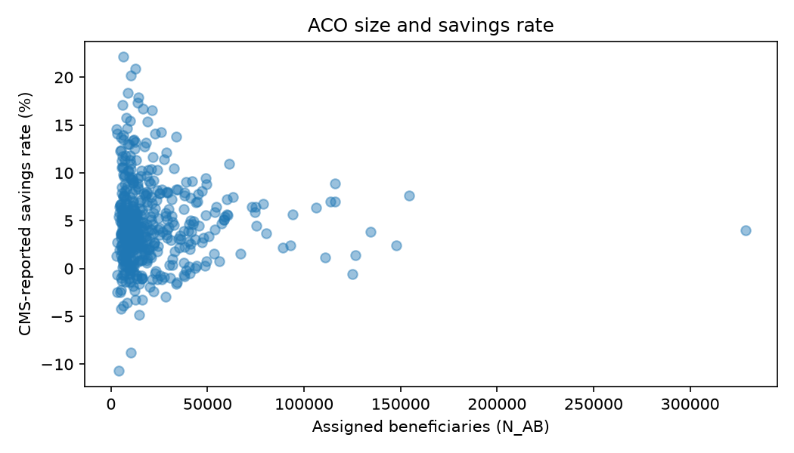
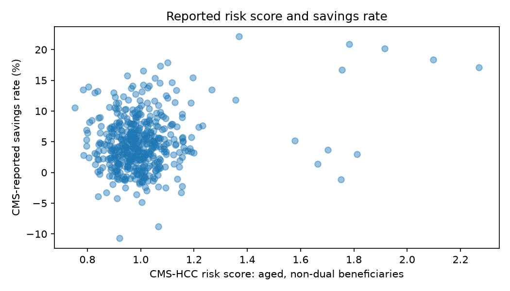
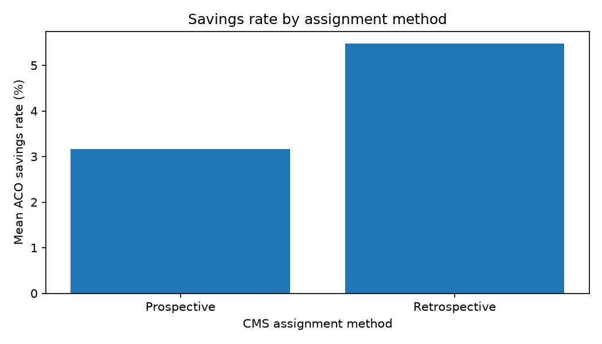

# Medicare ACOs: assigned patients, risk, and savings

A follow-up to my [MSSP financial monitoring project](https://github.com/honoluluhan717/medicare-mssp-aco-monitoring).

The first project looked at financial and quality results. Here I wanted to look at who ACOs are responsible for and whether patient mix and assignment methods are related to reported savings rates.

## Data

I use the original [CMS MSSP Performance Year 2024 financial and quality results](https://www.cms.gov/medicare/payment/fee-for-service-providers/shared-savings-program-ssp-acos/data), revised July 17, 2026. The original file is in `data/raw/`. These are real ACO-level results, not simulated patient data.

Five CMS fields are used:

| Field | Meaning |
| --- | --- |
| `ACO_ID` | ACO identifier |
| `N_AB` | Number of assigned beneficiaries |
| `Assign_Type` | CMS beneficiary assignment method |
| `Sav_rate` | Reported ACO savings rate, in percent |
| `CMS_HCC_RiskScore_AGND_PY` | Performance-year risk score for aged, non-dual beneficiaries |

The risk score describes **one beneficiary category**, not the ACO's entire population. It is not calculated here.

## Questions

1. **Does ACO size relate to savings?** Plot assigned beneficiaries against savings rate.
2. **Does patient risk relate to savings?** Plot the reported aged, non-dual CMS-HCC risk score against savings rate.
3. **Do assignment methods differ?** Compare the mean ACO savings rate by CMS assignment type.

The script `analyze.py` uses pandas and matplotlib. It writes three figures to `figures/`, an assignment summary to `results/assignment_summary.csv`, and sample sizes to `results/sample_sizes.csv`.

## Figures

## What these results can and cannot tell us

An ACO is held accountable for spending and quality for beneficiaries assigned under CMS rules. The assignment method and the number of assigned people are reported in this dataset, but individual assignment decisions cannot be recreated from it.

CMS-HCC risk scores reflect measured patient risk. Comparing scores across ACOs is **not** the same as reproducing CMS risk adjustment or its benchmark calculations. ACOs may differ in size, patient mix, geography, and program experience. All comparisons here are descriptive, with unweighted ACO averages; they do not show that assignment method or risk scores cause savings.

**Other payment arrangements:** MSSP uses shared savings and, in some tracks, shared losses relative to a benchmark. ACO REACH has included prospective population-based payments, while BPCI Advanced uses episode-based bundled payment accountability. These are different payment mechanisms; this MSSP dataset does not measure REACH capitation or BPCI episode reconciliation. See [CMS Innovation Center models](https://www.cms.gov/priorities/innovation/models).

## Files

- `analyze.py` — one short Python script
- `data/raw/` — original CMS file
- `figures/` — three charts
- `results/` — two summary tables

This is a small descriptive exercise using published CMS data, not an independent financial reconciliation or evaluation of a CMS payment model.
