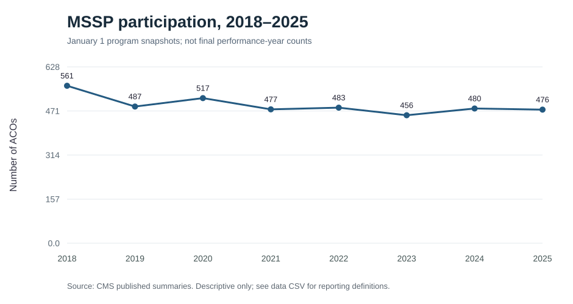
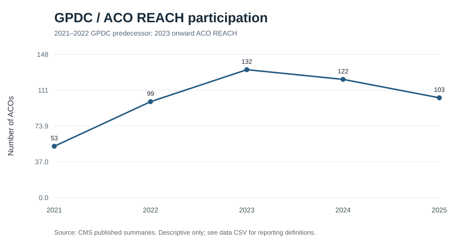
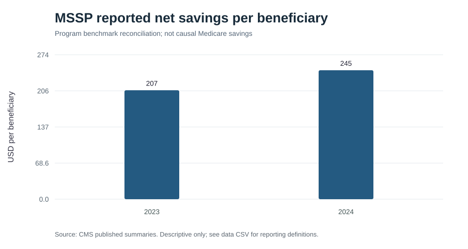
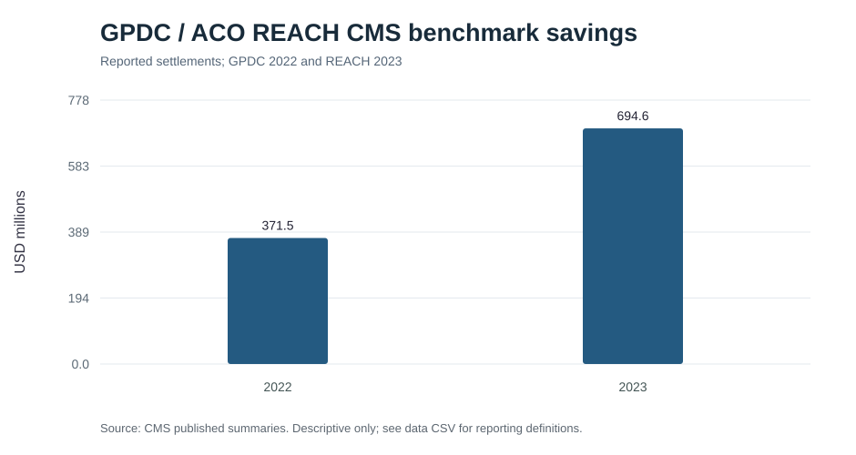
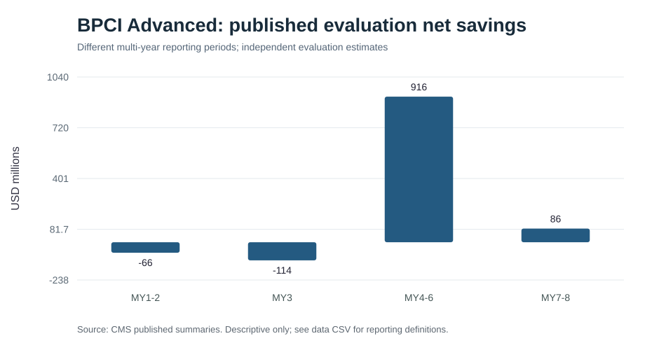
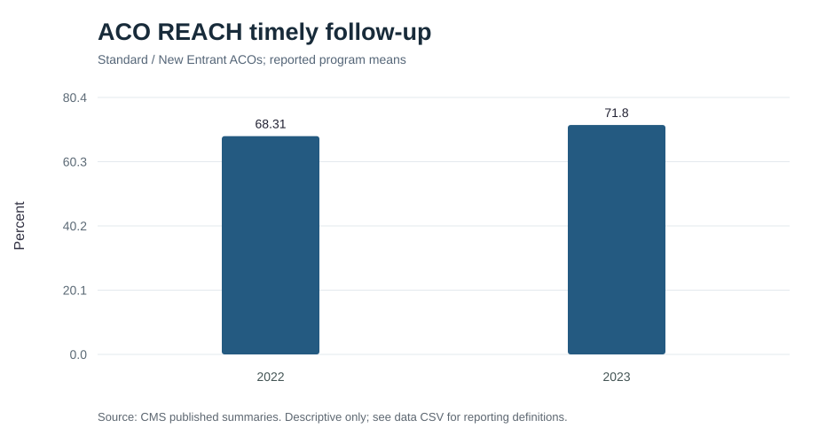

# Medicare alternative payment models: descriptive comparison

## Objective

This project reviews publicly reported participation, financial results, and quality indicators for three Medicare alternative payment models: the Medicare Shared Savings Program (MSSP), ACO REACH, and Bundled Payments for Care Improvement Advanced (BPCI Advanced). The aim is to describe changes within each program and document differences in payment design and reporting, rather than estimate program effects.

## Data

The analysis uses CMS program summaries, financial and quality results, and published evaluation findings. Values were transcribed from public reports; the source URL is retained with each record.

| File | Contents |
| --- | --- |
| `data/model_design.csv` | Payment unit, attribution, financial arrangements, quality framework, and benchmark methods |
| `data/participation.csv` | MSSP participation, 2018–2025; GPDC/ACO REACH participation, 2021–2025 |
| `data/financial_indicators.csv` | Selected program financial measures and BPCI Advanced evaluation estimates |
| `data/quality_indicators.csv` | Selected reported quality measures and evaluation findings |

GPDC (2021–2022) is shown as the predecessor to ACO REACH. MSSP January 1 participation snapshots are kept separate from final performance-year results.

## Methods

I summarized model characteristics and plotted available participation, financial, and quality measures within each program. No beneficiary-level data were used. The figures are based on published aggregate values; they do not involve independent risk adjustment or re-estimation of program savings.

Financial measures require particular care. MSSP and ACO REACH report settlement results relative to program benchmarks, while the BPCI Advanced figures shown here come from a published evaluation. The dollar amounts therefore should not be treated as a common measure of program performance. Quality measures also differ in definition and population across models.

## Results

### Participation

MSSP participation is presented using January 1 program snapshots. GPDC and ACO REACH counts are presented as a separate series because they refer to a different program and reporting basis.





### Financial results

The MSSP chart shows reported net savings per beneficiary for 2023 and 2024. The GPDC/ACO REACH chart shows CMS savings relative to program benchmarks for 2022 and 2023. The BPCI Advanced chart summarizes published evaluation estimates by model-year period; those periods are not of equal length.







### Quality

The available ACO REACH timely follow-up measure is shown for 2022 and 2023. Other quality indicators are retained in the source table but are not combined into a cross-model score.



## Interpretation and limitations

The programs differ in the unit of financial accountability (ACO population versus clinical episode), attribution rules, risk arrangements, and quality measurement. These distinctions affect how their published results can be interpreted.

This is a descriptive review of selected published indicators, not a comparative effectiveness study. The reporting periods and denominators are not fully aligned. BPCI Advanced results reflect evaluation estimates, whereas MSSP and ACO REACH financial results shown here reflect program reporting. The ACO REACH financial series currently ends in 2023. No causal conclusions or cross-model rankings are drawn.

## Reproducibility

Install the required Python packages and run the analysis from the repository root:

```bash
pip install pandas matplotlib
python analyze.py
```

The script writes figures and source-linked tables to `results/`. The figures embedded above are also available in `figures/`. Source documents are linked in the input CSV files.
